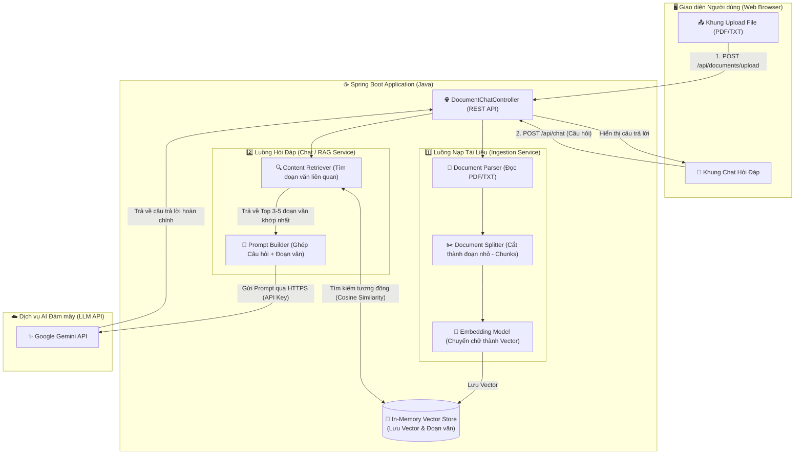

# 📄 Kiến Trúc Hệ Thống: Chat With Your Document (Java RAG Application)

Dự án này là một ứng dụng **RAG (Retrieval-Augmented Generation)** xây dựng bằng **Java Spring Boot** và **LangChain4j**, kết nối với **Google Gemini API** (LLM). Ứng dụng cho phép người dùng tải lên tài liệu cá nhân (PDF, TXT, DOCX) và đặt câu hỏi trực tiếp về nội dung bên trong tài liệu đó.

---

## 1. Công Nghệ Sử Dụng (Tech Stack)

| Thành phần | Công nghệ lựa chọn | Vai trò trong hệ thống |
| :--- | :--- | :--- |
| **Ngôn ngữ & Nền tảng** | **Java 17+** | Ngôn ngữ lập trình chính. |
| **Backend Framework** | **Spring Boot 3.x** | Cung cấp RESTful API, quản lý Dependency Injection và Web Server. |
| **AI / LLM Framework** | **LangChain4j** | Thư viện trung tâm giúp kết nối LLM API, đọc file, cắt nhỏ văn bản (Chunking) và tìm kiếm ngữ nghĩa. |
| **LLM Service (API)** | **Google Gemini API** (`gemini-1.5-flash` / `gemini-2.0-flash`) | Mô hình ngôn ngữ lớn dùng để sinh câu trả lời tự nhiên dựa trên ngữ cảnh tài liệu (Có gói Free Tier). |
| **Embedding Model** | **All-MiniLM-L6-v2 (In-process)** hoặc **Gemini Text Embedding** | Chuyển đổi văn bản thành các con số (Vector) để máy tính hiểu được ngữ nghĩa mà không tốn phí. |
| **Vector Store** | **InMemoryEmbeddingStore** | Lưu trữ các đoạn văn bản đã chuyển thành Vector ngay trên RAM (nhanh, gọn, không cần cài đặt DB rời). |
| **Đọc tài liệu** | **Apache PDFBox** (tích hợp qua LangChain4j) | Trích xuất chữ từ file PDF/TXT. |
| **Frontend (Giao diện)** | **HTML5 / CSS (Tailwind) / Vanilla JS** | Giao diện Web trực quan gồm khung Upload file và khung Chat (nằm ngay trong `src/main/resources/static`). |
| **Quản lý gói (Build Tool)** | **Maven** | Quản lý các thư viện (dependencies) và đóng gói ứng dụng. |

---

## 2. Kiến Trúc Tổng Quan & Luồng Hoạt Động (System Architecture)

Hệ thống RAG hoạt động qua **2 giai đoạn chính**:
1. **Giai đoạn 1 - Nạp tài liệu (Document Ingestion Flow):** Khi người dùng tải file lên.
2. **Giai đoạn 2 - Hỏi & Đáp (Retrieval & Generation Flow):** Khi người dùng gửi câu hỏi.

### Sơ đồ Kiến trúc (Mermaid Diagram)



---

## 3. Giải Thích Chi Tiết 2 Luồng Dữ Liệu

### Luồng 1: Nạp tài liệu (Ingestion)
Khi bạn tải lên một file PDF dài 50 trang, nếu gửi cả 50 trang cho AI mỗi lần hỏi sẽ rất tốn kém và chậm. Do đó hệ thống sẽ:
1. **Parse:** Đọc toàn bộ chữ trong file PDF.
2. **Chunking (Cắt nhỏ):** Chia tài liệu thành các đoạn nhỏ (ví dụ: mỗi đoạn khoảng 300 - 500 từ, có gối đầu lên nhau một chút để không mất mạch văn).
3. **Embedding (Mã hóa vector):** Biến mỗi đoạn văn thành một mảng số học (Vector) đại diện cho ý nghĩa của đoạn đó.
4. **Store:** Lưu cặp `(Vector, Nội dung đoạn văn gốc)` vào `InMemoryEmbeddingStore`.

### Luồng 2: Hỏi & Đáp với AI (Retrieval & Generation)
Khi người dùng hỏi: *"Chính sách nghỉ phép năm của công ty là bao nhiêu ngày?"*
1. **Embedding câu hỏi:** Câu hỏi của người dùng cũng được chuyển thành Vector.
2. **Retrieval (Truy xuất):** Hệ thống so sánh Vector câu hỏi với các Vector trong kho lưu trữ để lấy ra **3 đoạn văn có ý nghĩa giống câu hỏi nhất**.
3. **Augmentation (Bổ sung ngữ cảnh):** Hệ thống tự động tạo ra một câu lệnh (Prompt) ẩn như sau:
   > *"Dựa vào thông tin tài liệu dưới đây: [Đoạn văn 1, Đoạn văn 2, Đoạn văn 3]. Hãy trả lời câu hỏi của người dùng: Chính sách nghỉ phép năm là bao nhiêu ngày? Nếu không có trong tài liệu, hãy nói không biết."*
4. **Generation (Sinh câu trả lời):** Gửi câu lệnh trên qua **Google Gemini API** và nhận câu trả lời trả về cho người dùng.

---

## 4. Cấu Trúc Thư Mục Dự Án (Directory Structure)

Dưới đây là cấu trúc chuẩn của một dự án **Spring Boot + LangChain4j** chuyên nghiệp, gọn gàng để đưa lên GitHub:

```text
AI services (LLM APIs)/
├── pom.xml                                      # File cấu hình Maven (Khai báo Spring Boot, LangChain4j, PDFBox)
├── ARCHITECTURE.md                              # Tài liệu kiến trúc hệ thống (File hiện tại)
├── README.md                                    # Hướng dẫn cài đặt và chạy dự án (Hiển thị trên trang chủ GitHub)
├── .gitignore                                   # Bỏ qua thư mục build (target/) và file chứa API Key nhạy cảm
│
└── src/
    ├── main/
    │   ├── java/
    │   │   └── com/example/docchat/
    │   │       ├── DocChatApplication.java      # Hàm main() khởi chạy ứng dụng Spring Boot
    │   │       │
    │   │       ├── config/
    │   │       │   └── AiConfig.java            # Cấu hình kết nối Gemini API Key, Vector Store, Embedding Model
    │   │       │
    │   │       ├── controller/
    │   │       │   └── ChatController.java      # REST API nhận request Upload file và Chat từ giao diện Web
    │   │       │
    │   │       ├── service/
    │   │       │   ├── DocumentIngestionService.java  # Xử lý đọc file PDF/TXT, cắt đoạn và lưu vào Vector Store
    │   │       │   └── DocumentAssistant.java         # Interface AI Service của LangChain4j định nghĩa System Prompt
    │   │       │
    │   │       └── dto/
    │   │           ├── ChatRequest.java         # Object nhận câu hỏi từ người dùng (JSON)
    │   │           └── ChatResponse.java        # Object trả câu trả lời về cho giao diện (JSON)
    │   │
    │   └── resources/
    │       ├── application.yml                  # Cấu hình cổng chạy (port 8080), giới hạn dung lượng file upload, API Key
    │       └── static/                          # Giao diện Web (Frontend)
    │           ├── index.html                   # Trang giao diện chính (Khung upload + Khung chat)
    │           ├── style.css                    # Trang trí giao diện hiện đại
    │           └── app.js                       # Code JavaScript gọi API xuống Spring Boot
    │
    └── test/
        └── java/
            └── com/example/docchat/
                └── DocChatApplicationTests.java # Unit Test cơ bản
```

---

## 5. Thiết Kế Các REST API Endpoints

Ứng dụng chỉ cần **2 API chính** cực kỳ rõ ràng và dễ hiểu:

### 1. API Tải tài liệu lên
* **Endpoint:** `POST /api/documents/upload`
* **Input:** `MultipartFile` (File `.pdf` hoặc `.txt`)
* **Output:**
  ```json
  {
    "status": "success",
    "message": "Đã đọc và ghi nhớ tài liệu: quy_che_cong_ty.pdf (42 đoạn văn)."
  }
  ```

### 2. API Chat với tài liệu
* **Endpoint:** `POST /api/chat`
* **Input:**
  ```json
  {
    "question": "Tóm tắt nội dung chính của tài liệu này giúp tôi?"
  }
  ```
* **Output:**
  ```json
  {
    "answer": "Tài liệu quy định về thời gian làm việc từ thứ 2 đến thứ 6, chế độ nghỉ phép 12 ngày/năm và quy trình bảo mật thông tin..."
  }
  ```

---

## 6. Lộ Trình Thực Hiện (Step-by-Step Roadmap)

Để hoàn thiện dự án này từ con số 0, chúng ta sẽ đi qua 5 bước nhỏ:
1. **Bước 1: Chuẩn bị môi trường & Lấy API Key** — Kiểm tra Java/Maven trên máy và lấy miễn phí `GEMINI_API_KEY` từ Google AI Studio.
2. **Bước 2: Khởi tạo khung dự án (Maven & `pom.xml`)** — Cài đặt các thư viện Spring Boot và LangChain4j.
3. **Bước 3: Viết phần lõi AI (Backend)** — Cấu hình Vector Store, viết hàm đọc file PDF và kết nối Gemini API.
4. **Bước 4: Xây dựng Giao diện Web (Frontend)** — Tạo trang chat đẹp mắt để tương tác.
5. **Bước 5: Chạy thử & Viết `README.md`** — Chạy ứng dụng thực tế và hoàn thiện tài liệu đẩy lên GitHub.
