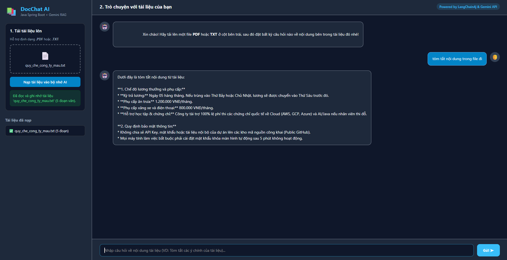

# 📚 DocChat AI - Hỏi Đáp Tài Liệu Với Java Spring Boot & Google Gemini API (RAG)

Một ứng dụng **RAG (Retrieval-Augmented Generation)** hoàn chỉnh được viết bằng **Java 17+**, **Spring Boot 3**, và **LangChain4j** kết hợp cùng **Google Gemini LLM API**.

Ứng dụng cho phép người dùng tải lên các tài liệu cá nhân (`.pdf`, `.txt`) và trò chuyện, đặt câu hỏi trực tiếp về nội dung bên trong tài liệu đó.



---

## ✨ Tính năng nổi bật
* **Tải tài liệu trực tiếp (PDF/TXT):** Tự động trích xuất văn bản bằng Apache PDFBox và cắt nhỏ thành các đoạn (Chunking).
* **Local Embedding miễn phí:** Chuyển văn bản thành Vector ngay trên máy bằng mô hình `All-MiniLM-L6-v2` mà không tốn phí gọi API Embedding.
* **In-Memory Vector Store & Chống trùng lặp:** Lưu trữ và tìm kiếm ngữ nghĩa tốc độ cao ngay trên RAM, hỗ trợ làm mới bộ nhớ tài liệu (`DELETE /api/documents`).
* **Tích hợp Google Gemini API (Auto-Fallback):** Sinh câu trả lời tự nhiên, chính xác bằng tiếng Việt, bám sát ngữ cảnh tài liệu và hạn chế ảo giác (Hallucination).

---

## 🚀 Hướng dẫn cài đặt và chạy dự án

### Bước 1: Lấy Google Gemini API Key (Miễn phí)
1. Truy cập [Google AI Studio](https://aistudio.google.com/app/apikey).
2. Đăng nhập tài khoản Google và nhấn **Create API Key**.
3. Copy mã API Key vừa tạo.

### Bước 2: Cấu hình API Key và Chạy ứng dụng
Đặt biến môi trường trên Terminal (PowerShell) và chạy trực tiếp bằng Maven Wrapper đi kèm:

```powershell
$env:GEMINI_API_KEY="DÁN_API_KEY_CỦA_BẠN_VÀO_ĐÂY"
.\mvnw.cmd spring-boot:run
```

Sau khi ứng dụng khởi động, mở trình duyệt tại địa chỉ: **`http://localhost:8080`**

---

## 🔌 REST API Endpoints

| Phương thức | Endpoint | Mô tả |
| :--- | :--- | :--- |
| `POST` | `/api/documents/upload` | Tải lên file `.pdf` hoặc `.txt`, cắt đoạn và lưu vào Vector Store |
| `DELETE` | `/api/documents` | Xóa toàn bộ tài liệu đã nạp trong bộ nhớ AI |
| `POST` | `/api/chat` | Gửi câu hỏi (`{"question": "..."}`) và nhận câu trả lời từ Gemini |

---

## 🏗️ Kiến trúc hệ thống
Xem chi tiết luồng hoạt động (Mermaid Diagram) và cấu trúc thư mục tại file [ARCHITECTURE.md](./ARCHITECTURE.md).
